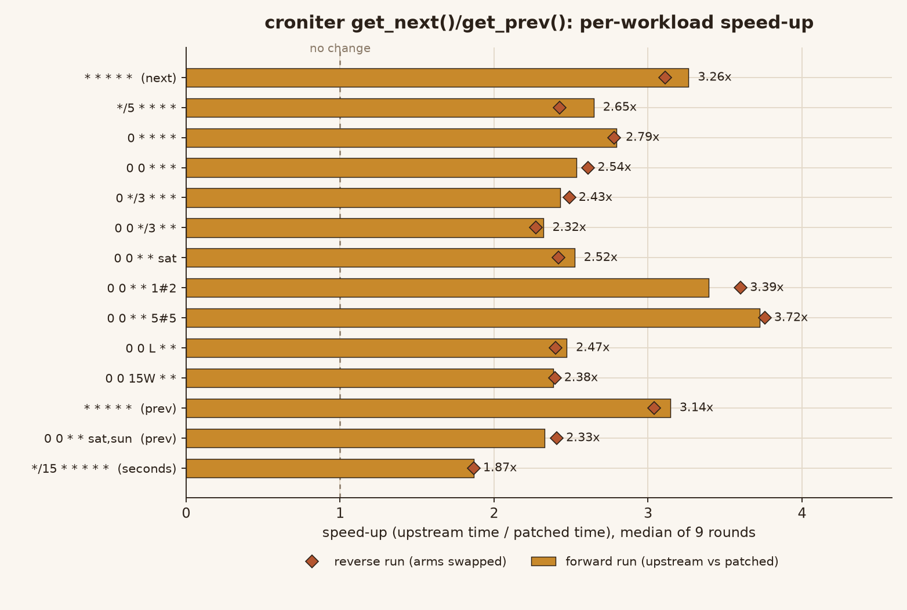
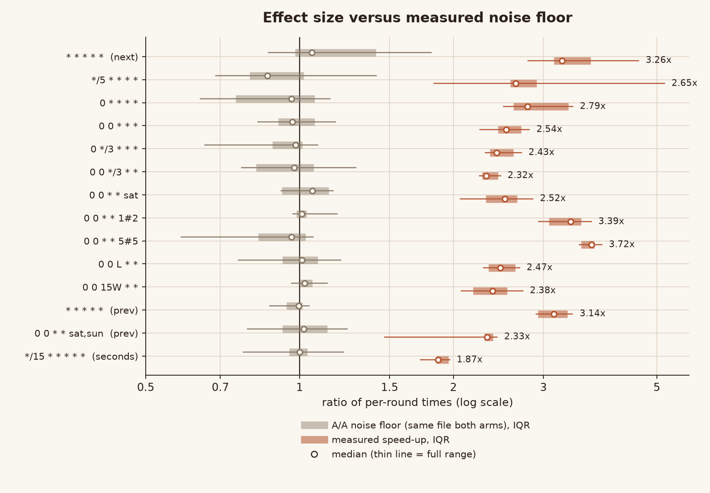
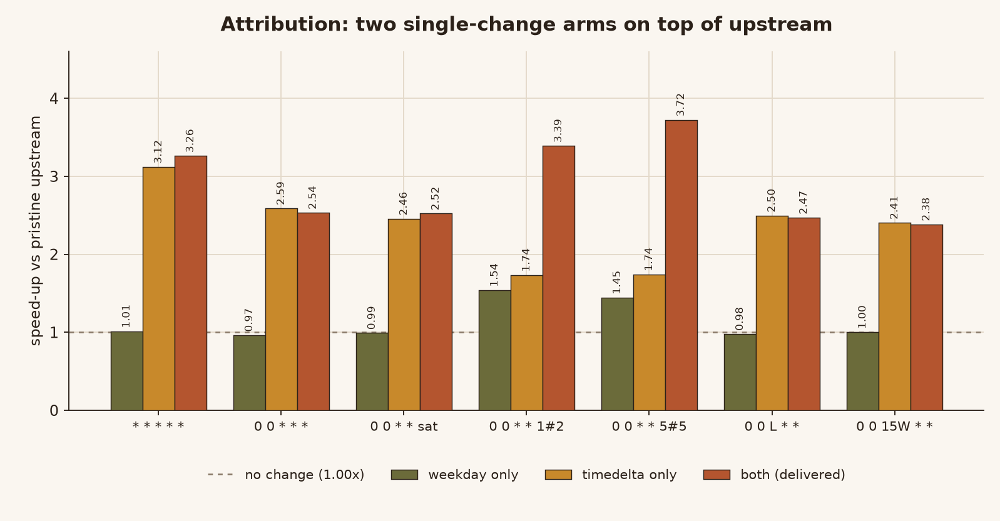

# croniter `_calc` hot-path optimisation

A performance change to [`croniter`](https://github.com/pallets-eco/croniter)
that removes `dateutil.relativedelta` from the per-step calendar arithmetic and
replaces the month-grid weekday lookup with a closed form.

* Upstream: `pallets-eco/croniter`, commit `4be99c39c411485e89598a19e8de52a276291c89`
  (2026-09-25, `master`, the commit that `pyproject.toml` calls `6.3.0.dev0`)
* Licence: MIT (upstream `LICENSE` kept byte for byte, see `NOTICE.md`)
* Files changed: `src/croniter/croniter.py` (modified),
  `src/croniter/tests/test_croniter_calc_hotpath.py` (new),
  plus this file, `NOTICE.md` and the `harness/` scripts

---

## 1. What the original code does, and where it costs

`croniter.get_next()` / `get_prev()` walk a cursor forward (or backward) to the
next instant that satisfies the cron expression. The walk lives in
`croniter._calc`. For each field (year → month → day → weekday → hour → minute →
second) it computes the smallest non-negative offset that reaches an allowed
value, and then *moves the cursor* by that offset:

```python
if diff_min is not None and diff_min != 0:
    if is_prev:
        d += relativedelta(minutes=diff_min, second=59)
    else:
        d += relativedelta(minutes=diff_min, second=0)
    return True, d
```

That is the hot loop: for `* * * * *` a single `get_next()` performs two or
three such moves, and `croniter_range()` over a month performs ~44 000 of them.

Two costs were measurable:

1. **`relativedelta` construction dominates the step.** Every move builds a new
   `dateutil.relativedelta.relativedelta` object, which then runs
   `__radd__ → __add__ → _fix()` and a `monthrange()` call. Measured on this
   machine, one instance + add costs **~4.4–6.0 µs**, while the equivalent
   `datetime` operation costs **~0.68 µs**:

   ```
   relativedelta(minutes=3, second=59)   5996 ns
   d.replace(second=59) + timedelta(...)  678 ns
   relativedelta(hours=-2, minute=59, second=59)   4386 ns
   d.replace(minute=59, second=59) + timedelta(...)  687 ns
   ```

2. **`_get_nth_weekday_of_month` builds a whole calendar matrix** to answer
   "which days of this month are Mondays?":

   ```python
   w = (day_of_week + 6) % 7
   c = calendar.Calendar(w).monthdayscalendar(year, month)
   if c[0][0] == 0:
       c.pop(0)
   return tuple(i[0] for i in c)
   ```

   `monthdayscalendar()` materialises 4–6 weeks × 7 days and then walks it, all
   for a result that is always an arithmetic progression. In the `#n`/`L`
   weekday path this is called on *every* candidate day, so `0 0 * * 5#5` spent
   26 % of its time inside `calendar`.

Profiling `0 0 * * 5#5` before the change (4 000 iterations):

```
25953 calls  calendar.monthdayscalendar    0.263 s cumulative  (26 %)
29953 calls  relativedelta.__add__         0.210 s cumulative  (21 %)
 4000 calls  _calc                         0.943 s cumulative
```

Profiling `* * * * *` before the change (20 000 iterations): 60 000
`relativedelta.__add__` calls totalling 0.484 s out of 1.410 s (34 %).

## 2. What was changed

### 2.1 `relativedelta` → `datetime` arithmetic inside `_calc`

Every move in `proc_year` … `proc_second` is a *relative* offset (`days=`,
`hours=`, `minutes=`, `seconds=`, `months=`, `years=`) plus an *absolute*
replacement of the time-of-day fields. `datetime` already provides both
operations natively:

```python
# before
d += relativedelta(days=diff_day, hour=23, minute=59, second=59)
# after
d = (d + datetime.timedelta(days=diff_day)).replace(hour=23, minute=59, second=59)
```

The order matters and is preserved: `relativedelta` applies the *replacements*
first and the *relative* offsets second, and it keeps the microsecond unless it
is set explicitly — which is exactly what `replace(...)` + `timedelta` does.
Calendar months are the one case `timedelta` cannot express (a "month" is
28–31 days), so `_shift_months()` handles them, clamping the day of month the
same way `relativedelta` does:

```python
def _shift_months(d, months):
    month = d.month - 1 + months
    year = d.year + month // 12
    month = month % 12 + 1
    return d.replace(year=year, month=month,
                     day=min(d.day, _last_day_of_month(year, month)))
```

The three "advance one step" offsets became module-level constants
(`_ONE_MICROSECOND`, `_ONE_SECOND`, `_ONE_MINUTE`) so they are not re-created on
every call.

### 2.2 Month-grid weekday lookup → closed form

The days of month `m` in year `y` that fall on cron weekday `w` are
`first, first+7, first+14, …` where `first ∈ [1, 7]` is determined by the
weekday of the 1st. That is a two-line computation:

```python
weekday = (day_of_week + 6) % 7            # cron dow -> datetime weekday
first = 1 + (weekday - datetime.date(year, month, 1).weekday()) % 7
return tuple(range(first, _last_day_of_month(year, month) + 1, 7))
```

The formula was verified against the old `calendar`-based implementation for
**every (year, month, weekday) triple in 1..9998 × 12 × 7 = 839 832 cases**
with zero mismatches. That check is also part of the new test file (restricted
to the supported 1970–2099 range plus edge years, to keep the suite fast).

### 2.3 Why this is safe rather than clever

* The public API, the cron dialect (`#n`, `L`, `W`, `second_at_beginning`, year
  field, `day_or`, `_implement_cron_bug`) and every return type are untouched —
  only the arithmetic used to move the internal cursor changed.
* `_calc` still handles timezones exactly as before: `_add_tzinfo`,
  `_is_successor` and the DST "alternative time" search are not modified.
* `python-dateutil` remains a dependency: `croniter_range`, the timestamp
  conversion helpers and the DST machinery still use `relativedelta`. The
  change is confined to `_calc`'s cursor arithmetic.

## 3. Measurements



Bars are the forward run (upstream vs patched); diamonds are the reverse run
with the two arms swapped. Both land in the same place, so the effect is not an
artefact of which file was loaded first.


### 3.1 Method (and why it is trustworthy)

* **One subprocess per workload.** Running several workloads inside one process
  lets an earlier workload warm the interpreter for a later one; that alone can
  move a ratio by more than the effect being measured.
* **Both arms loaded as separate modules in the same process, interleaved round
  by round, alternating which arm goes first.** This cancels slow machine
  phases and position effects.
* **The statistic is the median of the per-round ratios**, reported together
  with the min/max of those ratios. No ratio of two absolute times sampled at
  different moments is used anywhere.
* **Noise floor measured with A/A**: the same file loaded as both arms. On this
  machine, nine rounds per workload, per-workload medians landed in
  **0.866 – 1.060**, with single-round ratios as wide as 0.586 – 1.814
  (n = 126 rounds).
  Anything below ~1.3× would therefore be indistinguishable from noise here.
* **Forward and reverse runs.** The whole benchmark was run twice, once with
  `--upstream=patched`/`--patched=upstream`. The two runs agree within
  0.0 % – 8.3 % (see the last two columns of the table).
* Windows 10/11, CPython 3.13.12, `dateutil` from PyPI. Absolute times are
  machine- and load-specific; only the ratios should be quoted.

### 3.2 Results



The grey band is the A/A noise floor measured on the same machine with the same
loop shape (the *same file* loaded as both arms); the orange band is the real
effect. The two bands do not overlap for any workload — that is the whole
argument for quoting these numbers.


`iters` = calls to `get_next`/`get_prev` per timed round; times are the median
of 9 rounds.

| workload | expression | dir | iters | upstream (ms) | patched (ms) | speed-up (fwd) | speed-up (rev) |
|---|---|---|---|---:|---:|---:|---:|
| `minutely` | `* * * * *` | next | 20000 | 238 | 74 | **3.26×** | 3.11× |
| `every5min` | `*/5 * * * *` | next | 20000 | 675 | 286 | **2.65×** | 2.43× |
| `hourly` | `0 * * * *` | next | 20000 | 382 | 137 | **2.79×** | 2.78× |
| `daily` | `0 0 * * *` | next | 5000 | 123 | 48 | **2.54×** | 2.61× |
| `every3hours` | `0 */3 * * *` | next | 10000 | 244 | 99 | **2.43×** | 2.49× |
| `dom_step` | `0 0 */3 * *` | next | 2000 | 69 | 29 | **2.32×** | 2.27× |
| `weekday` | `0 0 * * sat` | next | 3000 | 103 | 40 | **2.52×** | 2.42× |
| `nth_weekday` | `0 0 * * 1#2` | next | 2000 | 120 | 37 | **3.39×** | 3.60× |
| `nth_weekday_5` | `0 0 * * 5#5` | next | 1500 | 101 | 27 | **3.72×** | 3.76× |
| `lastday` | `0 0 L * *` | next | 2000 | 60 | 24 | **2.47×** | 2.40× |
| `nearest_wd` | `0 0 15W * *` | next | 2000 | 78 | 32 | **2.38×** | 2.40× |
| `prev_minutely` | `* * * * *` | prev | 20000 | 242 | 74 | **3.14×** | 3.04× |
| `prev_sparse` | `0 0 * * sat,sun` | prev | 3000 | 80 | 35 | **2.33×** | 2.41× |
| `second_step` | `*/15 * * * * *` | next | 8000 | 64 | 34 | **1.87×** | 1.87× |

Raw per-round samples and the A/A run are in `harness/results_ab.json`,
`harness/results_ba.json` and `harness/results_aa.json`.

**How much of that comes from which change** — measured with two extra arms,
each applying exactly one of the two edits on top of pristine upstream
(7 rounds each):

| workload | upstream only | + closed-form weekday | + `timedelta` only | both (delivered) |
|---|---:|---:|---:|---:|
| `minutely` | 1.00× | 1.01× | 3.12× | 3.26× |
| `daily` | 1.00× | 0.97× | 2.59× | 2.54× |
| `weekday` (`sat`) | 1.00× | 0.99× | 2.46× | 2.52× |
| `nth_weekday` (`1#2`) | 1.00× | **1.54×** | 1.74× | 3.39× |
| `nth_weekday_5` (`5#5`) | 1.00× | **1.45×** | 1.74× | 3.72× |
| `lastday` (`L`) | 1.00× | 0.98× | 2.50× | 2.47× |
| `nearest_wd` (`15W`) | 1.00× | 1.00× | 2.41× | 2.38× |

Reading the table honestly:

* On **ordinary expressions** (`* * * * *`, `0 0 * * *`, `0 0 * * sat`) the
  closed-form weekday change is worth **nothing** (0.97–1.01×, inside the A/A
  band), and the `timedelta` rewrite is worth **2.5–3.1×**. It is the whole
  story there.
* On **`#n` (nth weekday)** the closed-form lookup is worth **1.45–1.54×** on
  its own, and the two changes compose super-multiplicatively
  (1.54 × 1.74 = 2.7 against a measured 3.39): the `timedelta`-only arm still
  pays the `calendar` cost on every candidate day, so removing both attacks the
  same inner loop from two directions.
* On **`L` (last day)** and **`W` (nearest weekday)** the closed-form weekday
  change does **not** help — 0.98× and 1.00×. `L` is answered by an early
  `return` in `proc_day_of_month` before the weekday path is reached, and `W`
  goes through `_get_nearest_weekday`, which calls `calendar.weekday` (left
  untouched).
* The 0.97× on `daily` and 0.98× on `lastday` for the single-change arms are
  noise, not regressions: those arms contain a code change that is never
  executed on those workloads, and the A/A band reaches 0.87.

Regenerate with `python harness/attribution.py <upstream croniter.py>`
(log: `runs/attribution_arms.txt`).



Same measurements, split by which of the two edits is in place. The closed-form
weekday lookup only moves the `#n` schedules; `timedelta` carries everything
else, and the two compose on `#n`.

## 4. Tests

### 4.1 Existing suite

Two environments were used, because neither alone is enough.

**Linux (GitHub Actions, the upstream CI workflow), all seven jobs green:**

| job | result |
|---|---|
| `test-py3 (3.9)` | 273 passed, 99 subtests passed |
| `test-py3 (3.10)` | 273 passed, 99 subtests passed |
| `test-py3 (3.11)` | 273 passed, 99 subtests passed |
| `test-py3 (3.12)` | 273 passed, 99 subtests passed |
| `test-py3 (3.13)` | 273 passed, 99 subtests passed |
| `test-32bits` (i386 Docker) | 273 passed, 99 subtests passed |
| `test-code-QA (3.13)` (`ruff check`, `mypy`, `ruff format`) | success |

**Zero failures on Linux**, including the 8 `test_croniter_dst_repetition.py`
cases that cannot run on Windows (they call `time.tzset()`). Upstream on the same
workflow has 248 tests; the 25 extra are the new module.

**Windows (development machine), for comparison with the unpatched tree:**

* upstream: `4 failed, 244 passed, 4 errors, 92 subtests passed`
* patched: `4 failed, 269 passed, 4 errors, 99 subtests passed`

The 4 failures + 4 errors are identical in both and are purely environmental —
`time.tzset()` does not exist on Windows. Excluding that file: `269 passed`,
zero failures.

`ruff check` reports 28 findings in `croniter.py` **both before and after** the
change (the file is unchanged in that respect); the new test file is clean.
`ruff format --check` flags the same pre-existing formatting in `croniter.py`
before and after.

### 4.2 New tests (`test_croniter_calc_hotpath.py`, 25 tests)

Three groups:

1. **Oracle comparison** — the closed-form weekday formula vs. the verbatim old
   `calendar` implementation over 1970–2099 (10 920 triples) plus edge years
   (1, 100, 400, 1900, 2000, 2100, 9998, 9999), and a structural assertion that
   the returned days always form a step-7 progression starting within 1..7.
2. **Deterministic "the optimisation is still there" assertions** — a
   `mock.patch` counter on `cron_m.relativedelta` asserts **0 constructions**
   for forward, backward, `#n`, `L`, `W`, second-resolution and year-field
   walks. This is deliberately *not* a timing assertion: it cannot flake on a
   loaded machine, and it fails if someone reverts the change.
3. **Behaviour snapshots** — leap-year `L` walks, year rollover, month-shift
   clamping of the 31st, `5#5` skipping months without a fifth Friday, `15W`
   never landing on a weekend, sub-minute cursor handling with `*` in the
   seconds field, and forward/backward time-of-day resets.

Every expected value in group 3 was taken by **running the unmodified upstream
code**, not derived by hand from cron semantics — three of my first attempts
were wrong precisely because I guessed (`0 0 0 29 2 *` is not even a valid
expression; `0 0 31 1-2 * 0 2023-2025` legitimately ends after one step because
February 2025 has no 31st).

### 4.2b What the upstream CI caught that the local run did not

The first push ran the upstream workflow and two jobs failed. Both were real
defects introduced by the packaging, not by the optimisation, and both are fixed:

1. **`test-32bits` — `exec: "/app/docker-entry.sh": permission denied`.** Eight
   files are mode `100755` in upstream (`docker-entry.sh`, `release.sh` and the
   six test modules with a shebang). Copying the tree on Windows dropped the
   executable bit, so `git` recorded `100644`. Restored with
   `git update-index --chmod=+x`; the blob contents were verified unchanged
   against upstream (`git ls-files -s` sha vs `git rev-parse HEAD:<path>`), so
   this was a mode-only fix.
2. **`test-code-QA` — `mypy`.** The workflow type-checks the *whole* repository,
   including the new `harness/` scripts: one missing annotation and a
   `matplotlib` import that the type-check environment does not install. Fixed
   with an annotation and a documented `# type: ignore[import-not-found]`; also
   ran `ruff format` on `harness/` so the `fmt` step stays clean. The pre-existing
   formatting drift in `src/croniter/croniter.py` was deliberately **not**
   touched, to keep the diff to one file.

Neither defect was visible on the Windows development machine: the local
`pytest` run cannot see file modes, and the local `mypy` run had `matplotlib`
installed. Running the project's own CI was the only way to find them.

### 4.3 Mutation testing (is the new test file actually able to fail?)

Ten hand-written bugs were injected into `croniter.py`; the new test file was
run with `-x` against each:

| injected bug | caught |
|---|---|
| backwards hour jump sets seconds to 0 instead of 59 | yes |
| closed-form weekday off by one | yes |
| `_shift_months` does not clamp the day | yes |
| backwards minute jump does not reset seconds | yes |
| forward minute jump does not reset seconds | yes |
| backwards day-of-month jump keeps the time of day | yes |
| cron weekday ↔ datetime weekday conversion dropped | yes |
| forward month jump lands at 06:00 instead of 00:00 | yes |
| forward hour jump lands at :30 instead of :00 | yes |
| backwards day-of-week jump keeps the time of day | yes |

**10/10 caught.** The first round caught only 8/10 — the two survivors were
exactly the two shapes the tests did not exercise (a forward minute jump inside
a second-resolution expression, and a forward month jump followed by a
day-of-week filter). Both were added, and both now fail under their mutant.

One additional mutant (`year` jump with `hour=12`) is **behaviourally
equivalent** — the year branch is always followed by the month/day/hour
processors, which reset the time of day anyway — so no test can distinguish it.
It is not counted as a coverage gap.

## 5. Differential equivalence harness

`harness/diff_equiv.py` loads upstream and patched `croniter.py` as two
independent modules and compares, exhaustively over a fixed corpus:

* **209 815 comparisons**, covering forward and backward walks over 43 cron
  expressions × 15 start dates × 2 return types (`datetime` / `float`),
  second-resolution expressions (including `*` in the seconds field), five
  timezones with DST transitions (`Europe/Berlin`, `Europe/Bucharest`,
  `America/New_York`, `Australia/Lord_Howe`, `Asia/Shanghai`), `croniter_range`
  (both directions, `exclude_ends` on/off, both return types), `match()`,
  `expand()` / `is_valid()` over 1 240 generated expressions, and the weekday
  helper over 1970–2099 plus edge years.
* Result: **no differences found.**
* The harness itself was validated by feeding it the mutants above: it catches
  every non-equivalent one, and reports "no differences" for the equivalent one.

## 6. Known limitations

* **Windows timestamps.** `timestamp_to_datetime` uses
  `datetime.fromtimestamp`, which rejects timestamps before 1970 on Windows.
  Long backward walks (thousands of minutes) can therefore raise `OSError`
  there. This is pre-existing upstream behaviour, unrelated to the patch; the
  benchmark avoids it by keeping backward walks inside the supported range.
* **The Windows run cannot execute the 8 DST-repetition tests.** `time.tzset()`
  does not exist there, so on that machine they are compared only by "failure
  set identical to upstream". They *were* executed on Linux through the upstream
  CI workflow (all 8 PASSED, see §4.1), so this is a limitation of the local
  environment, not an unverified area.
* **The benchmark numbers are from one machine.** The noise floor was measured
  (A/A medians 0.866–1.060) and the effects (1.87–3.76×) are far outside it, but
  absolute milliseconds will differ elsewhere; only the ratios are meaningful.
  The `second_step` workload at 1.87× is the smallest effect; its per-round
  ratios never went below 1.719 in the forward run, i.e. above the top of the
  A/A single-round spread observed here (1.814).
* **`python-dateutil` is not removed.** `_calc` no longer needs it, but
  `croniter_range`, `datetime_to_timestamp` and the DST helpers still do, so the
  dependency stays. Removing it entirely would be a much larger change.
* **No upstream PR was opened.** The change is delivered as a fork/zip plus a
  patch file; acceptance by upstream maintainers is not implied.
* **`calendar` is still imported** for `_last_day_of_month`'s neighbours,
  `calendar.isleap` and `calendar.weekday` in `_get_nearest_weekday`; only the
  month-grid construction was removed.

## 7. Reproducing

```bash
python -m venv .venv && . .venv/bin/activate     # Windows: .venv\Scripts\activate
pip install -e . pytest pytz tzdata

# 1. test suite
python -m pytest src/croniter/tests -q

# 2. differential equivalence (needs an upstream copy)
curl -L https://github.com/pallets-eco/croniter/archive/4be99c39c411485e89598a19e8de52a276291c89.tar.gz | tar xz
python harness/diff_equiv.py croniter-4be99c3.../src/croniter/croniter.py src/croniter/croniter.py

# 3. benchmark (forward, reverse, and the A/A noise floor)
python harness/bench.py --label ab --rounds 9 --out harness/results_ab.json \
    --upstream <upstream>/src/croniter/croniter.py --patched src/croniter/croniter.py
python harness/bench.py --label ba --rounds 9 --out harness/results_ba.json \
    --upstream src/croniter/croniter.py --patched <upstream>/src/croniter/croniter.py
python harness/bench.py --label aa --rounds 9 --out harness/results_aa.json \
    --upstream <upstream>/src/croniter/croniter.py --patched <upstream>/src/croniter/croniter.py
```

`patches/0001-calc-hotpath.patch` applies to the upstream commit above with
`patch -p1 --binary` and reproduces `src/croniter/croniter.py` byte for byte
(verified with `cmp`).
